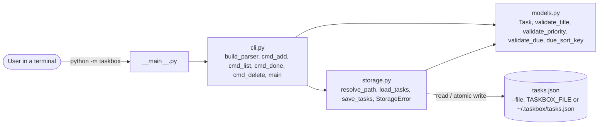

# Architecture: taskbox modules

Dependencies point one way: `cli` -> `storage` -> `models`; `cli` also imports `models` directly.
Evidence: imports in `taskbox/cli.py:10-20`, `taskbox/storage.py:11`; entry `taskbox/__main__.py:3-5`; path resolution `taskbox/storage.py:21-28`.
Not rendered in this session (no Mermaid renderer available).
