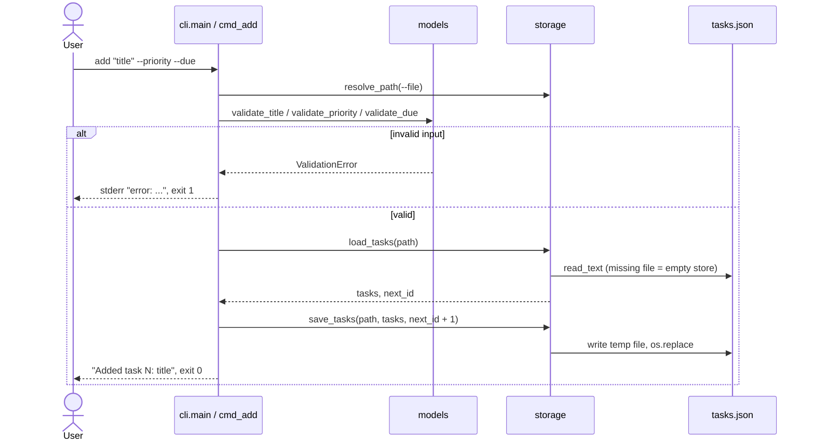

# Sequence: `taskbox add`

Evidence: `taskbox/cli.py:105-112` (main), `taskbox/cli.py:54-62` (cmd_add), `taskbox/storage.py:31-80`. A `StorageError` from `load_tasks` or `save_tasks` is reported the same way as `ValidationError` (stderr, exit 1; `taskbox/cli.py:110-112`), omitted from the diagram to stay readable.
Not rendered in this session.
