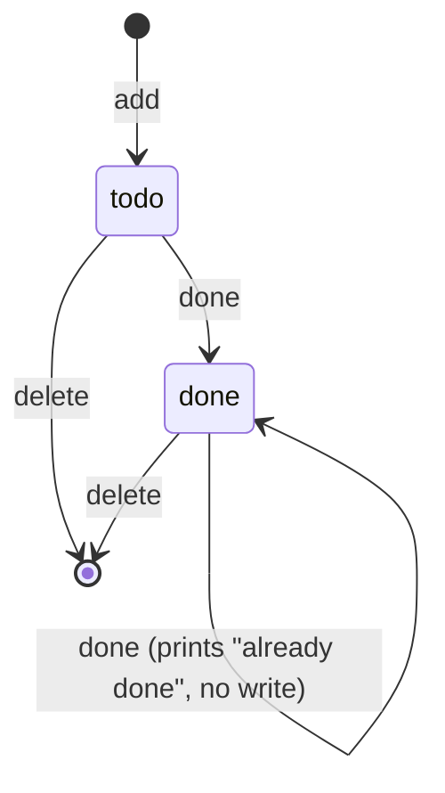

# State machine: Task.status

`STATUSES = ("todo", "done")` in `taskbox/models.py:11`. New tasks start as `todo` (`taskbox/models.py:28`). `cmd_done` sets `done` (`taskbox/cli.py:87`) and leaves an already-done task unchanged (`taskbox/cli.py:84-86`). `cmd_delete` removes the task (`taskbox/cli.py:96`). No code path sets a task back to `todo`.
Not rendered in this session.
