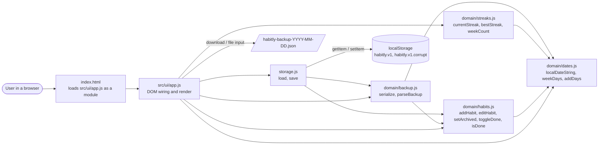

# Architecture: habitly modules

Shows which file imports which, and where data is kept.

*Figure 1: Architecture - habitly modules*

`src/storage.js` receives the storage object as an argument (`load(store)`, `save(store, state)`); `app.js` passes `localStorage` (`habitly/src/ui/app.js:24,174`). Nothing in `src/domain/` touches the DOM or `localStorage`.

Evidence: `habitly/src/ui/app.js:1-5`, `habitly/src/storage.js:1-5`, `habitly/src/domain/backup.js:1-2`, `habitly/src/domain/habits.js:1`, `habitly/src/domain/streaks.js:1`, `habitly/index.html:61`, `habitly/src/ui/app.js:146-155`.
Not rendered in this session (no Mermaid renderer available); syntax checked by hand.
