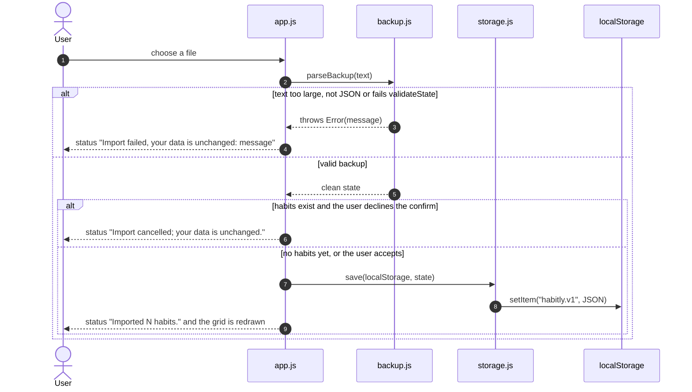

# Sequence: import a backup file

Shows what happens when the user picks a JSON file in **Import JSON file**, including the cases where nothing changes.

*Figure 2: Sequence - import a backup*

The file input is cleared at the end in every branch (`ev.target.value = ''`).

Evidence: `habitly/src/ui/app.js:175-190`, `habitly/src/domain/backup.js:14-47`, `habitly/src/storage.js:41-48`.
Not rendered in this session (no Mermaid renderer available); syntax checked by hand.
