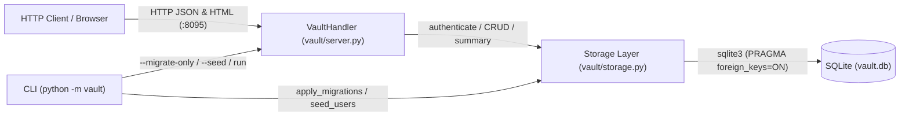
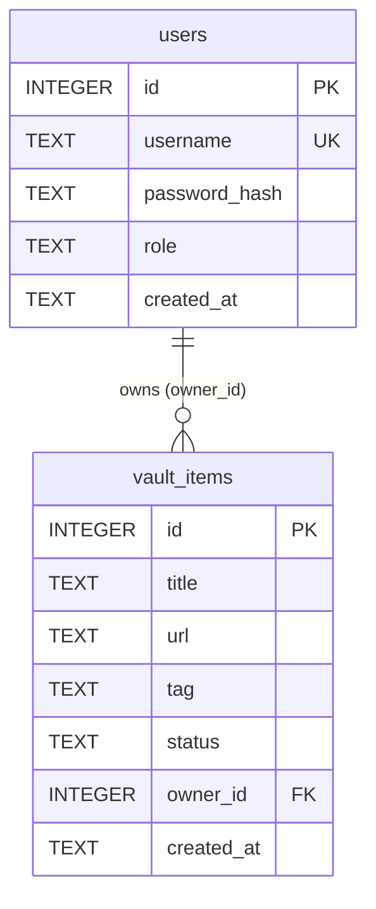

# Vault Architecture and ERD

System architecture and logical entity-relationship diagram for Vault, derived from `vault/__main__.py`, `vault/server.py`, `vault/storage.py`, and `vault/migrations/001_init.sql`.

## System Architecture

Vault runs as a single-process Python `ThreadingHTTPServer` backed by a local SQLite database file (`vault/server.py:236-241`, `vault/storage.py:37-41`).

Evidence: `vault/__main__.py:11-28`, `vault/server.py:77-241`, `vault/storage.py:37-158`.

## Logical ERD

Database schema for `users` and `vault_items` (`vault/migrations/001_init.sql:2-18`).

Evidence: `vault/migrations/001_init.sql:2-21`.
