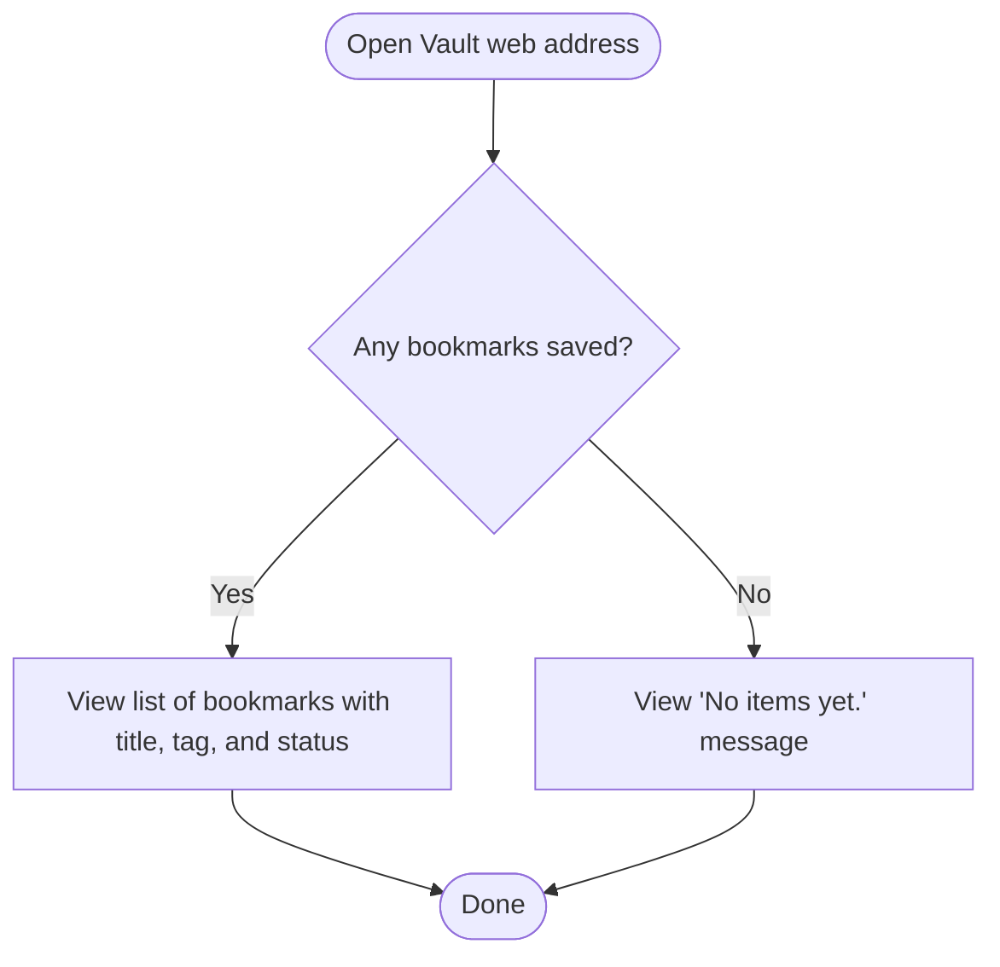

# Report 6 - Release Package & User Guides (Vault)

## I. Record of Changes

| Date | A* / M, D | In charge | Change Description |
|---|---|---|---|
| 2026-11-27 | A | `[Cần bổ sung: tên]` | Initial release package, installation guide, and user manual for Vault (`09a555a`) |

(`*A - Added, M - Modified, D - Deleted`)

## II. Release Package & User Guides

### 1. Deliverable Package

| No. | Deliverable Item | Description |
|---|---|---|
| 1 | Source Codes | `vault/` (`__init__.py`, `__main__.py`, `server.py`, `storage.py`), commit `09a555a` (Python) |
| 2 | Database Script(s) | `vault/migrations/001_init.sql`, commit `09a555a` (SQLite DDL) |
| 3 | Test Cases Document | `tests/test_vault.py`, commit `09a555a` (`unittest` integration and validation tests) |

### 2. Installation Guides

#### 2.1 System Requirements

- **Runtime:** Python `3.12` (tested in `.github/workflows/ci.yml:16`; also verified on Python `3.14.6`).
- **Dependencies:** None (Python standard library only).
- **Database:** SQLite (bundled with Python `sqlite3`).
- **Supported browsers:** `[Cần bổ sung: supported browsers — not declared in repository]`

#### 2.2 Installation Instruction

1. Clone the repository and open a terminal at the repository root.
2. Set the required signing secret environment variable `VAULT_SECRET` (`vault/server.py:238-240`). Never commit or share this value.
3. Initialize the database schema and seed the initial `admin` and `bob` accounts (`vault/__main__.py:16-25`, `vault/storage.py:57-69`):

```bash
python -m vault --db vault.db --seed --migrate-only
```

4. Start the Vault web server (`vault/__main__.py:13-15, 26`):

```bash
python -m vault --host 127.0.0.1 --port 8095 --db vault.db
```

5. Open `http://127.0.0.1:8095/` in a web browser.

### 3. User Manual

#### 3.1 Overview

Vault displays saved bookmarks and snippets on a single web page titled **Vault Bookmark Manager** (`vault/server.py:66-73`).

- **Roles:** `admin` and `member` exist in the system (`vault/migrations/001_init.sql:6`), but the web page at `/` is public and read-only (`vault/server.py:122-129`).
- **Scope note:** Creating, archiving, and deleting bookmarks, signing in, and viewing the admin summary are not present in the web interface (`vault/server.py:55-74`); those actions are only available through the [Vault API](api.md).

| Screen | Guest (unauthenticated) | Member | Admin |
|---|---|---|---|
| **Vault Bookmark Manager** (`/`) | X (view list) | X (view list) | X (view list) |

#### 3.2 Workflow 1: View Saved Bookmarks

- **Purpose:** View the list of saved bookmarks, including each item's title, tag, and status (`vault/server.py:55-62`).
- **Who can do this:** Anyone with access to the Vault web address.
- **What you need first:** The Vault application must be running.



**Steps:**

1. Open the Vault web address (`http://127.0.0.1:8095/`) in your browser.
   [Screenshot: Vault Bookmark Manager - header "Vault Bookmark Manager" and list of saved items - circle in red: the main item list]
   - **Expected result (when bookmarks exist):** You see the heading **Vault Bookmark Manager** followed by a list showing each bookmark's title in bold, its `[tag]`, and its status (`active` or `archived`) (`vault/server.py:58-68`).
   - **Expected result (when no bookmarks exist):** You see **No items yet.** (`vault/server.py:62`).

**Common problems:**

- **Page does not load:** Confirm the application was started with `VAULT_SECRET` configured (ask your administrator).
- **Cannot add or edit bookmarks on the page:** The current web page is view-only; use the [API guide](api.md) or contact your administrator.
